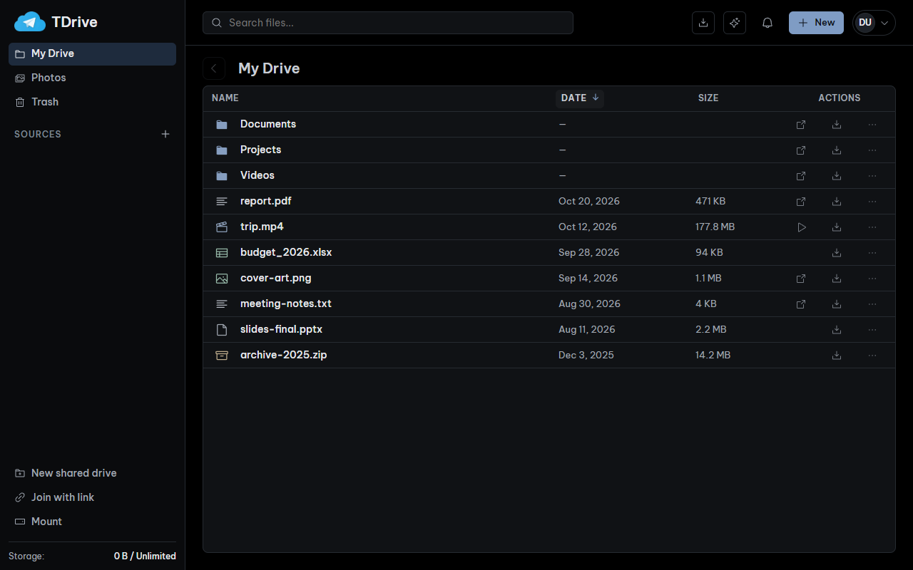
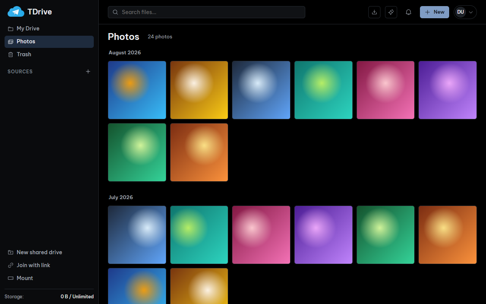
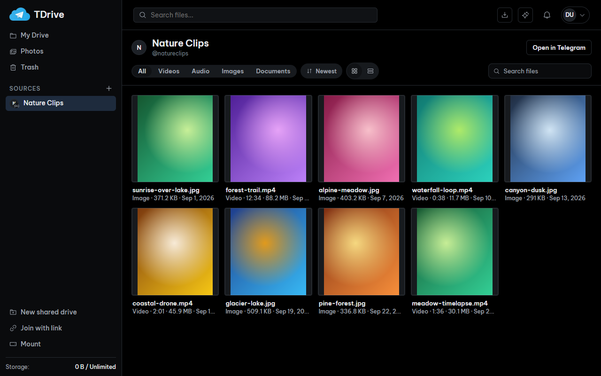
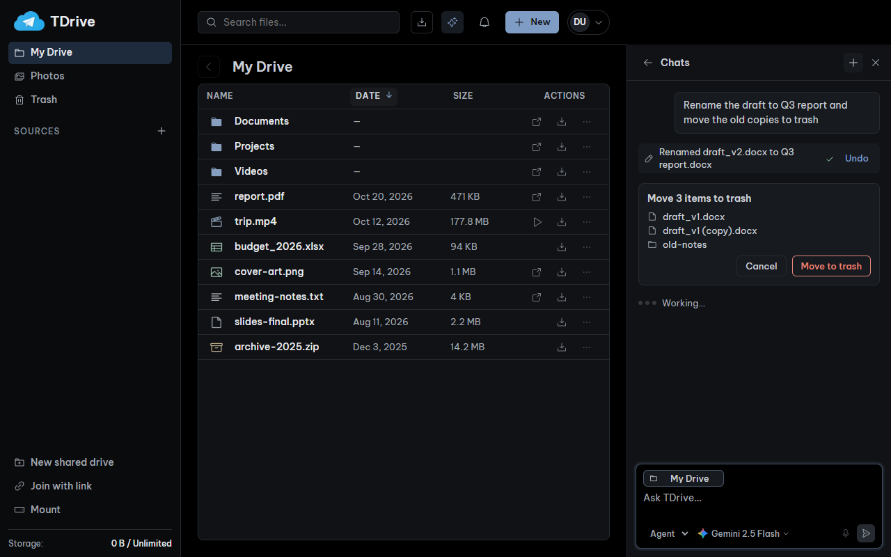
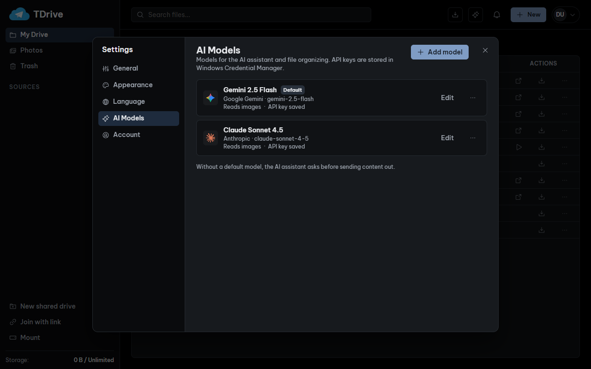
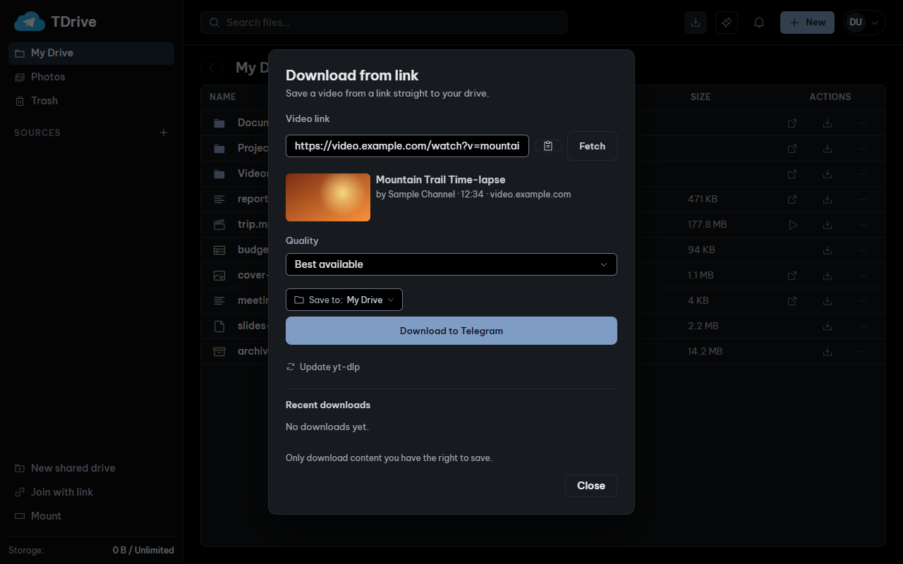
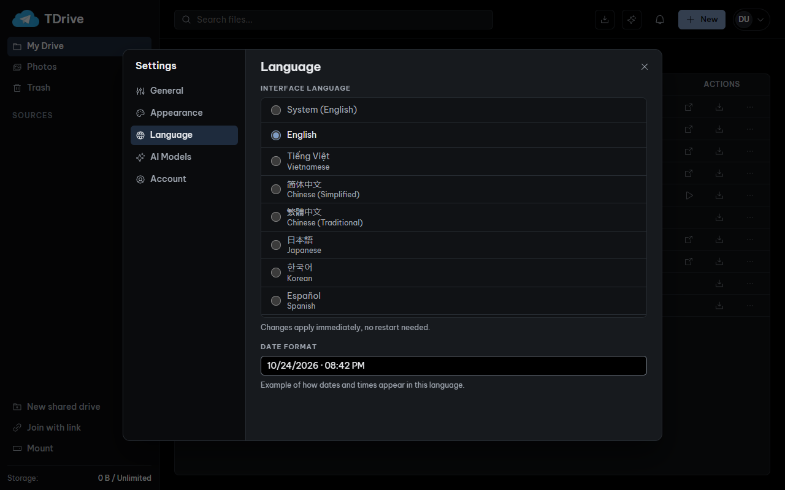
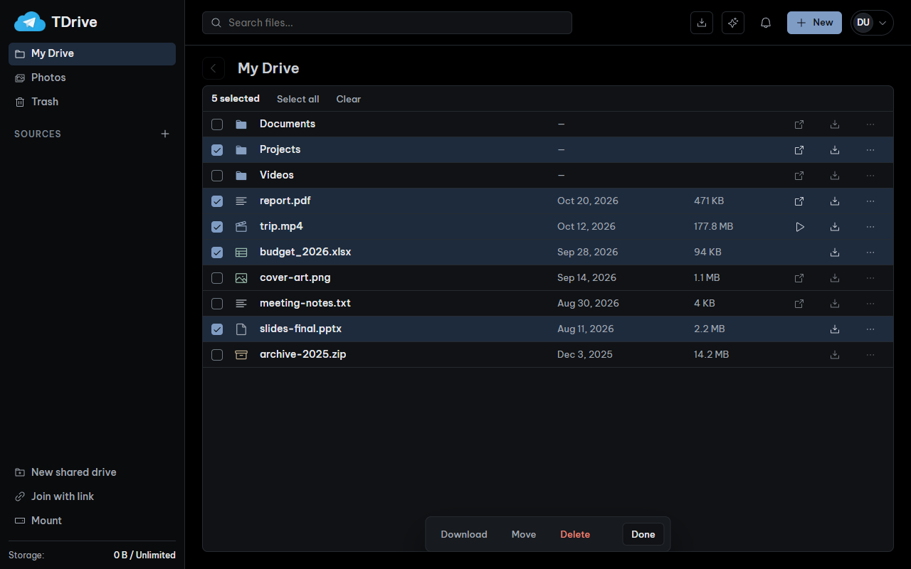

<div align="center">


<h1>TDrive</h1>

<p><b>Your private cloud drive, built on Telegram.</b></p>

<p>
  <a href="https://github.com/ndgthuan/tdrive/releases/latest"></a>
  <a href="LICENSE"></a>
  
  
  
</p>

<p>
  
  <a href="https://github.com/ndgthuan/tdrive/stargazers"></a>
  <a href="https://github.com/ndgthuan/tdrive/network/members"></a>
  <a href="https://github.com/ndgthuan/tdrive/actions/workflows/ci.yml"></a>
</p>

<p><b>[English]</b> &nbsp;·&nbsp; <a href="README.vi.md">Tiếng Việt</a></p>

<p>
  <a href="docs/architecture/README.md"><b>Documentation</b></a> &nbsp;·&nbsp;
  <a href="https://github.com/ndgthuan/tdrive/releases/latest"><b>Download</b></a> &nbsp;·&nbsp;
  <a href="https://github.com/ndgthuan/tdrive/releases"><b>Releases</b></a>
</p>

</div>



TDrive turns a private Telegram channel into a folder tree you can browse, search, stream, share and mount. Files stay in Telegram. TDrive adds the organizing, previewing and AI-assisted tidying on top.

## Core capabilities

- **Files and folders** — Nested folders with rename, move, drag and drop, search, and a Trash that can be restored or emptied.
- **Shared drives with roles** — Collaborate in shared drives with the roles Owner, Manager, Editor or Viewer.
- **Windows drive mount** — Mount your drive in Windows Explorer, where it appears as Telegram Drive.
- **Automatic phone backup** — Back up photos and videos from your phone into a My Drive folder named after the device.
- **Download from link** — Save media from a link with yt-dlp and upload it straight to Telegram. Available on desktop, Android and iPhone.
- **AI assistant** — An Agent mode that can act on your drive and an Ask mode that only answers. Every change shows an approval card and can be reverted with Undo. Photo and video organizing shows a preview before anything is applied.
- **Media viewer and streaming** — Preview images, PDF, text, code, audio and video, and stream media straight from Telegram.
- **19 languages** — The interface is available in 19 languages and can be changed in Settings.
- **Verified desktop updates** — Updates are checked against a signed checksum manifest before they are installed on the next launch.
- **Privacy** — AI API keys are kept in your operating system's credential store, and your files stay in your own Telegram account. Optional client-side encryption is available for personal-drive contents.

## Download

Ready-made builds are on the [**Releases page**](https://github.com/ndgthuan/tdrive/releases/latest). Open the newest release, scroll to **Assets**, and pick the file for your device. You do not need to build anything.

| Device | File to download | Notes |
|---|---|---|
| Windows 10/11 (64-bit) | `TDrive-<version>-windows-amd64-setup.exe` | Installer. A portable `...-windows-amd64.zip` is next to it. |
| macOS (Apple silicon) | `TDrive-<version>-macos-arm64.zip` | Unzip and drag TDrive to Applications. See the first-launch note below. |
| Linux (64-bit) | `TDrive-<version>-x86_64.AppImage` | `chmod +x` it, then run it. Needs glibc 2.35 or newer. |
| Android 7.0 or newer (ARM64) | `TDrive-<version>-android-arm64.apk` | Allow installs from your browser or file manager when Android asks. |
| iPhone / iPad (iOS 16 or newer) | `TDrive-<version>-ios-unsigned.ipa` | Not signed. Install with TrollStore, Sideloadly or AltStore. |
| Command line | `...-cli.zip` / `...-cli.tar.gz` | The `tdrive` CLI for scripting. |

Every release also ships `checksums.txt` and a signed `checksums.txt.sig`, so you can verify what you downloaded.

**Desktop updates.** Windows, macOS and Linux check for new releases and download them in the background by default. Downloaded updates are verified and installed on the next launch. You can turn automatic downloads off in settings, or install and restart immediately from there.

**macOS first launch.** The app is not notarized. If macOS says it cannot verify the developer, open **System Settings > Privacy & Security** and choose **Open Anyway**.

**Android.** The APK is signed with this fork's own key, so it cannot update over the original TDrive. Uninstall the original first if you have it.

**iOS.** There is no App Store or TestFlight build. The IPA is for sideloading only.

Prefer to compile it yourself? See [Build from source](#build-from-source).

## Screenshots

| | |
|---|---|
|  |  |
| **My Drive.** Folders and files in one list, with actions always visible. | **Photos.** A gallery grouped by month. |
|  |  |
| **Sources.** A public Telegram channel as a read-only grid. | **AI agent.** Renames and moves with Undo, and asks before trashing. |
|  |  |
| **AI models.** Connect Gemini or Claude and pick a default. | **Download from link.** Pick quality and destination, then upload to Telegram. |
|  |  |
| **Languages.** 19 interface languages, applied instantly. | **Multi-select.** Download, move or delete a batch at once. |

## Platform support and status

This fork is under active development. The desktop app is the focus and has had the most testing so far.

- **Newer and only lightly tested:** the mobile apps (Android and iOS), shared-drive roles with multiple Telegram accounts, and the iOS downloader on physical devices. The AI assistant and the link downloader are also new. Simulator and browser checks do not replace testing on a real iPhone or Android device.
- **iOS has no ffmpeg.** Formats that need separate audio and video streams merged, or audio conversion, are unavailable. Choose a combined format.
- **No background execution.** Keep the app open while link downloads or the first large photo backup finish. Automatic backup does not run while the app is closed.
- **Desktop tools.** Automatic installation of yt-dlp and ffmpeg is Windows-only. On macOS and Linux, install them yourself and make them available on your `PATH`.
- **Upgrading.** Do not downgrade to v2.x after using v3.x on the same account, because older builds cannot read the captions written by v3.x. The Android APK from this fork is signed with its own key and cannot update over the original TDrive.

## Inherited from upstream TDrive

These features come from the upstream project and still work in this fork:

- Client-side encryption (XChaCha20-Poly1305) for personal-drive contents, with a vault password.
- Encrypted backup of photos and videos from selected desktop folders or Android storage.
- Shared drives with instant-join or approval-required invite links.
- Files over 2 GB split across Telegram messages and presented as one file, with interrupted unencrypted uploads resumable.
- Archive import (`.zip`, `.tar`, `.tar.gz`) and recursive folder download.
- A `tdrive` command-line tool with a background daemon, for scripts and agents.
- Mounting a personal drive as a local WebDAV volume in Finder, Explorer or a Linux file manager.

## Build from source

<details>
<summary><b>Show build steps</b></summary>

Follow these steps to build TDrive from source instead of using a release.

### 1. Get Telegram API credentials

1. Sign in at [my.telegram.org/apps](https://my.telegram.org/apps) and create an application to get an **API ID** and **API hash**. Telegram's [setup guide](https://core.telegram.org/api/obtaining_api_id) explains the steps.
2. Keep both values private. TDrive stores them locally; the project does not ship a shared credential.

### 2. Build

Requirements: the Go version in [go.mod](go.mod), Node.js 22 with npm, and the native dependencies for your platform. See the [build guide](build/README.md) and the [Wails installation guide](https://v3.wails.io/getting-started/installation/).

Run these from the repository root:

```bash
go install github.com/wailsapp/wails/v3/cmd/wails3@v3.0.0-beta.22

npm --prefix frontend ci
npm --prefix frontend run build

# Desktop app, with hot reload
wails3 dev

# Desktop binary into build/bin
wails3 task build

# Command-line tool
go build -o build/bin/tdrive ./cmd/tdrive
```

Use `wails3 task package` for a platform package (`.app`, NSIS installer or AppImage).

### 3. First launch

1. Enter your API ID and API hash in the setup screen.
2. Sign in with your phone number, the login code, and your 2FA password if you have one.
3. Choose the Telegram channel that holds your existing My Drive, or create an empty one.
4. Upload a file, create a folder, or join a shared drive.

On a second device, sign in with the same account and pick the same channel. If encryption is enabled, unlock it with your existing vault password.

</details>

## How it works

- **My Drive** is a private Telegram channel that you own.
- **Shared drives** are Telegram megagroups. Members collaborate in them.
- File contents are sent as document messages. Files over 2 GB are split into immutable parts and joined again on download.
- Folder structure and changes are stored as small, readable metadata messages, for example `TDrive | type=rename | object=f:42 | name=new.png`. Older `TDX1|...` messages still read correctly.
- Local SQLite is a projection of that history. It can be rebuilt by replaying the Telegram messages, so losing the local cache does not lose the drive.
- Optional encryption happens on your device before anything is sent. Telegram only sees ciphertext for encrypted files.

Do not edit or delete `TDrive | ...` messages in the Telegram app. Doing so can desynchronize the drive. Permanent deletion is the only operation that removes them, and TDrive performs it for you.

## Safety

- TDrive is an independent project. It is not affiliated with or endorsed by Telegram.
- Use it according to Telegram's terms, and keep your own backups of anything that matters.
- Treat your API hash, login session, vault password and invite links like passwords. Redact them from logs and screenshots.
- Telegram availability, rate limits and account restrictions are outside the app's control.

## Project layout

```text
backend/        Go services: ai, mediadl (yt-dlp), mountdav, photobackup, sync, tgclient, crypto, ...
frontend/       Svelte 5 and TypeScript UI (src/ui, src/i18n, src/locales)
internal/app/   Wails application wiring
cmd/tdrive/     Command-line tool
cmd/tdrived/    Background daemon
build/          Wails task files and platform packaging
docs/           Architecture notes and screenshots
```

Architecture notes are in [docs/architecture](docs/architecture/README.md).

## Development

Backend and desktop:

```bash
wails3 task build
go build ./...
go vet ./...
```

Frontend, from `frontend/`:

```bash
npm run typecheck
npm run test
npm run build
```

Run Go tests by package, not all at once. On Windows, do not run `go test ./...` wholesale: `backend/mountos` tests touch the live mount. Target the packages you changed, for example:

```bash
go test ./backend/ai/...
go test ./backend/mediadl/...
```

Browser end-to-end tests use `npm run test:e2e` from `frontend/`.

Contribution and testing notes are in [CONTRIBUTING.md](CONTRIBUTING.md) and [TESTING.md](TESTING.md).

## Credits

Original TDrive by Jeetraj (https://github.com/jeetrex17/TDrive), MIT License. This fork is maintained by Nguyễn Dương Gia Thuận (https://github.com/ndgthuan).

Thank you to the projects this fork builds on:

- [Wails](https://wails.io) for the desktop shell.
- [gotd/td](https://github.com/gotd/td) for the Telegram client library.
- [Phosphor Icons](https://phosphoricons.com) for the interface icons.
- [Be Vietnam Pro](https://fonts.google.com/specimen/Be+Vietnam+Pro) for the UI typeface.
- [LobeHub icons](https://github.com/lobehub/lobe-icons) (MIT) for the AI provider logos.

The full list of third-party components and their licenses is in [NOTICE.md](NOTICE.md).

## License

This fork is distributed under the MIT License. See [LICENSE](LICENSE) and [NOTICE.md](NOTICE.md).

```text
Copyright (c) 2026 Jeetraj
Copyright (c) 2026 Nguyễn Dương Gia Thuận (modifications and additions in this fork)
```

The original TDrive copyright notice is retained.
