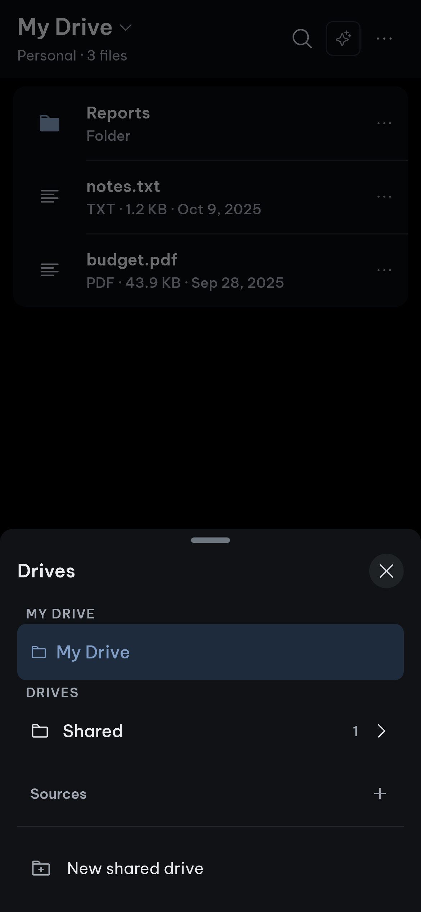
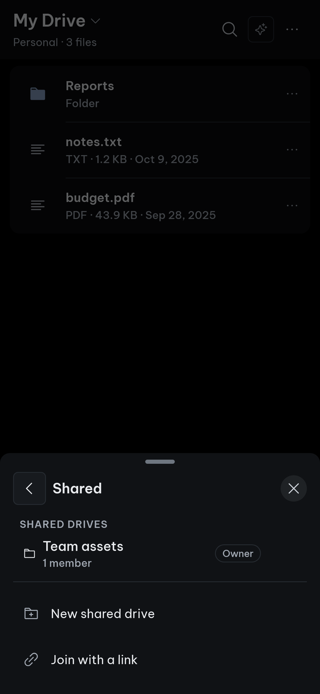
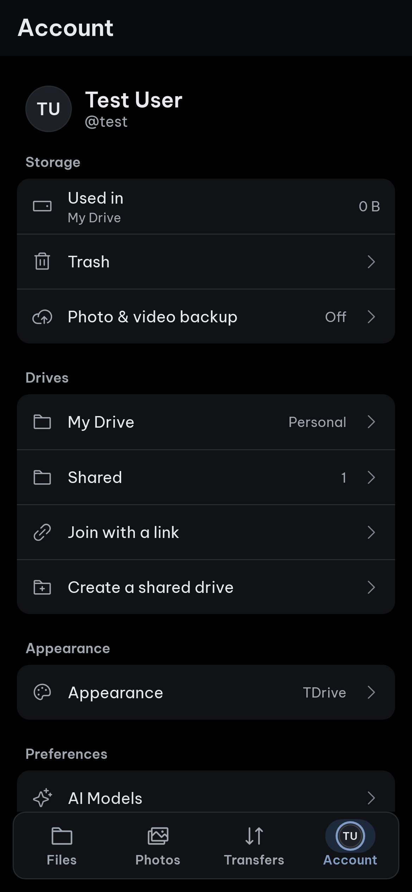
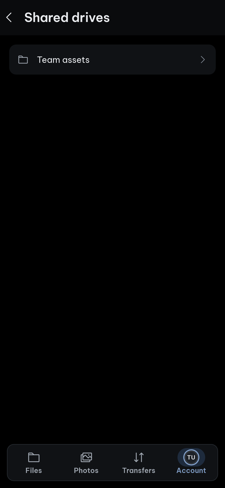

<div align="center">

<h1>TDrive</h1>


<p><b>Ổ đám mây riêng tư của bạn, xây dựng trên Telegram.</b></p>

<p>
  <a href="https://github.com/ndgthuan/tdrive/releases/latest"></a>
  <a href="LICENSE"></a>
  
  
  
</p>

<p>
  
  <a href="https://github.com/ndgthuan/tdrive/stargazers"></a>
  <a href="https://github.com/ndgthuan/tdrive/network/members"></a>
  <a href="https://github.com/ndgthuan/tdrive/actions/workflows/ci.yml"></a>
</p>

<p><a href="README.md">English</a> &nbsp;·&nbsp; <b>[Tiếng Việt]</b></p>

<p>
  <a href="docs/architecture/README.md"><b>Tài liệu</b></a> &nbsp;·&nbsp;
  <a href="https://github.com/ndgthuan/tdrive/releases/latest"><b>Tải về</b></a> &nbsp;·&nbsp;
  <a href="https://github.com/ndgthuan/tdrive/releases"><b>Các bản phát hành</b></a>
</p>

</div>

<div align="center">
<table align="center" width="100%">
  <tr>
    <td width="25%" align="center"><br><b>Home · Drives</b></td>
    <td width="25%" align="center"><br><b>Home · Shared</b></td>
    <td width="25%" align="center"><br><b>Account</b></td>
    <td width="25%" align="center"><br><b>Account · Drives</b></td>
  </tr>
</table>
</div>

TDrive biến kho lưu trữ Telegram riêng tư thành ổ đĩa để bạn duyệt, tìm kiếm, xem trước, chia sẻ và gắn vào máy tính.

## Tính năng chính

- **Tệp và thư mục** — Thư mục lồng nhau với đổi tên, di chuyển, kéo thả, tìm kiếm và Thùng rác có thể khôi phục hoặc làm trống.
- **Ổ dùng chung với vai trò** — Cộng tác trong ổ dùng chung với các vai trò Chủ sở hữu (Owner), Quản lý (Manager), Biên tập (Editor) hoặc Người xem (Viewer). Trên điện thoại, các ổ dùng chung đã tham gia được gom trong thư mục Shared ở cả Home và Account.
- **Gắn ổ đĩa trên Windows** — Gắn ổ của bạn vào Windows Explorer, nơi ổ hiển thị với tên Telegram Drive.
- **Sao lưu tự động từ điện thoại** — Sao lưu ảnh và video từ điện thoại vào một thư mục trong Ổ của tôi, được đặt tên theo thiết bị.
- **Tải xuống từ liên kết** — Lưu nội dung đa phương tiện từ liên kết bằng yt-dlp và tải thẳng lên Telegram. Có trên máy tính, Android và iPhone.
- **Trợ lý AI** — Chế độ Agent có thể thao tác trên ổ của bạn, còn chế độ Ask chỉ trả lời. Mỗi thay đổi đều hiển thị thẻ phê duyệt và có thể hoàn tác bằng Undo. Việc sắp xếp ảnh và video hiển thị bản xem trước trước khi áp dụng.
- **Trình xem và phát trực tuyến** — Xem trước ảnh, PDF, văn bản, mã nguồn, âm thanh và video, đồng thời phát đa phương tiện trực tiếp từ Telegram.
- **19 ngôn ngữ** — Giao diện có sẵn 19 ngôn ngữ và có thể đổi trong phần Cài đặt.
- **Cập nhật máy tính đã xác minh** — Bản cập nhật được kiểm tra dựa trên danh sách checksum đã ký trước khi được cài đặt vào lần mở ứng dụng tiếp theo.
- **Quyền riêng tư** — Khóa API của AI được lưu trong kho thông tin xác thực của hệ điều hành, và tệp của bạn vẫn nằm trong tài khoản Telegram của bạn. Có thể bật mã hóa phía máy khách cho nội dung ổ cá nhân.

## Tải về

Các bản dựng sẵn có tại [**trang Releases**](https://github.com/ndgthuan/tdrive/releases/latest). Mở bản mới nhất, cuộn đến mục **Assets** và chọn tệp phù hợp với thiết bị của bạn. Bạn không cần tự dựng gì cả.

| Thiết bị | Tệp cần tải | Ghi chú |
|---|---|---|
| Windows 10/11 (64-bit) | `TDrive-<version>-windows-amd64-setup.exe` | Trình cài đặt. Bên cạnh có bản portable `...-windows-amd64.zip`. |
| macOS (Apple silicon) | `TDrive-<version>-macos-arm64.zip` | Giải nén và kéo TDrive vào Applications. Xem ghi chú lần mở đầu tiên bên dưới. |
| Linux (64-bit) | `TDrive-<version>-x86_64.AppImage` | Chạy `chmod +x` rồi mở. Cần glibc 2.35 trở lên. |
| Android 7.0 trở lên (ARM64) | `TDrive-<version>-android-arm64.apk` | Cho phép cài đặt từ trình duyệt hoặc trình quản lý tệp khi Android hỏi. |
| iPhone / iPad (iOS 16 trở lên) | `TDrive-<version>-ios-unsigned.ipa` | Chưa ký. Cài bằng TrollStore, Sideloadly hoặc AltStore. |
| Dòng lệnh | `...-cli.zip` / `...-cli.tar.gz` | Công cụ dòng lệnh `tdrive` để viết script. |

Mỗi bản phát hành cũng kèm `checksums.txt` và `checksums.txt.sig` đã ký, để bạn kiểm tra tệp đã tải.

**Cập nhật máy tính.** Windows, macOS và Linux kiểm tra bản phát hành mới và mặc định tự tải xuống ở chế độ nền. Bản cập nhật đã tải sẽ được xác minh và cài đặt vào lần mở ứng dụng tiếp theo. Bạn có thể tắt tự động tải trong cài đặt, hoặc cài đặt và khởi động lại ngay từ đó.

**Lần mở đầu tiên trên macOS.** Ứng dụng chưa được notarize. Nếu macOS báo không thể xác minh nhà phát triển, hãy mở **System Settings > Privacy & Security** và chọn **Open Anyway**.

**Android.** APK được ký bằng khóa riêng của bản fork này, vì vậy nó không thể cập nhật đè lên TDrive gốc. Hãy gỡ TDrive gốc trước nếu bạn đang dùng.

**iOS.** Không có bản trên App Store hay TestFlight. Tệp IPA chỉ dùng để cài thủ công (sideload).

Muốn tự biên dịch? Xem [Build từ mã nguồn](#build-từ-mã-nguồn).

## Hỗ trợ nền tảng và tình trạng

Bản fork này đang được phát triển tích cực. Ứng dụng máy tính là trọng tâm và là phần được kiểm thử nhiều nhất cho đến nay.

- **Mới và mới chỉ kiểm thử sơ bộ:** ứng dụng di động (Android và iOS), vai trò trong ổ dùng chung với nhiều tài khoản Telegram, và bộ tải xuống trên iOS trên thiết bị thật. Trợ lý AI và bộ tải xuống từ liên kết cũng còn mới. Kiểm tra trên simulator hay trình duyệt không thay thế được việc kiểm thử trên iPhone hoặc điện thoại Android thật.
- **iOS không có ffmpeg.** Các định dạng cần ghép luồng âm thanh và video riêng, hoặc chuyển đổi âm thanh, sẽ không khả dụng. Hãy chọn định dạng gộp sẵn.
- **Không chạy nền.** Hãy giữ ứng dụng mở trong khi tải từ liên kết hoặc đợt sao lưu ảnh lớn đầu tiên hoàn tất. Sao lưu tự động không chạy khi ứng dụng đã đóng.
- **Công cụ trên máy tính.** Chỉ Windows mới tự động cài yt-dlp và ffmpeg. Trên macOS và Linux, hãy tự cài đặt và đặt chúng vào `PATH`.
- **Nâng cấp.** Không hạ cấp xuống v2.x sau khi đã dùng v3.x trên cùng tài khoản, vì bản cũ không đọc được chú thích do v3.x ghi. APK Android của bản fork này được ký bằng khóa riêng và không thể cập nhật đè lên TDrive gốc.

## Kế thừa từ TDrive gốc

Các tính năng sau đến từ dự án gốc và vẫn hoạt động trong bản fork này:

- Mã hóa phía máy khách (XChaCha20-Poly1305) cho nội dung ổ cá nhân, với mật khẩu kho.
- Sao lưu được mã hóa ảnh và video từ các thư mục máy tính đã chọn hoặc bộ nhớ Android.
- Ổ dùng chung với liên kết mời tham gia ngay hoặc cần được phê duyệt.
- Tệp lớn hơn 2 GB được chia thành nhiều tin nhắn Telegram và hiển thị như một tệp; các lần tải lên chưa mã hóa bị gián đoạn có thể tiếp tục.
- Nhập kho nén (`.zip`, `.tar`, `.tar.gz`) và tải xuống thư mục đệ quy.
- Công cụ dòng lệnh `tdrive` với tiến trình nền (daemon), dùng cho script và agent.
- Gắn ổ cá nhân thành ổ WebDAV cục bộ trong Finder, Explorer hoặc trình quản lý tệp trên Linux.

## Build từ mã nguồn

<details>
<summary><b>Hiển thị các bước build</b></summary>

Làm theo các bước sau để build TDrive từ mã nguồn thay vì dùng bản phát hành.

### 1. Lấy thông tin API của Telegram

1. Đăng nhập tại [my.telegram.org/apps](https://my.telegram.org/apps) và tạo một ứng dụng để lấy **API ID** và **API hash**. [Hướng dẫn của Telegram](https://core.telegram.org/api/obtaining_api_id) mô tả các bước.
2. Giữ hai giá trị này riêng tư. TDrive lưu chúng cục bộ; dự án không kèm theo thông tin xác thực dùng chung.

### 2. Build

Yêu cầu: phiên bản Go trong [go.mod](go.mod), Node.js 22 với npm, và các phụ thuộc gốc cho nền tảng của bạn. Xem [hướng dẫn build](build/README.md) và [hướng dẫn cài đặt Wails](https://v3.wails.io/getting-started/installation/).

Chạy các lệnh sau từ thư mục gốc của repository:

```bash
go install github.com/wailsapp/wails/v3/cmd/wails3@v3.0.0-beta.22

npm --prefix frontend ci
npm --prefix frontend run build

# Ứng dụng máy tính, có hot reload
wails3 dev

# Tệp nhị phân máy tính vào build/bin
wails3 task build

# Công cụ dòng lệnh
go build -o build/bin/tdrive ./cmd/tdrive
```

Dùng `wails3 task package` để tạo gói cho nền tảng (`.app`, trình cài đặt NSIS hoặc AppImage).

### 3. Lần mở đầu tiên

1. Nhập API ID và API hash vào màn hình thiết lập.
2. Đăng nhập bằng số điện thoại, mã đăng nhập và mật khẩu 2FA nếu bạn có.
3. Chọn kênh Telegram chứa Ổ của tôi hiện có, hoặc tạo một kênh trống.
4. Tải tệp lên, tạo thư mục, hoặc tham gia một ổ dùng chung.

Trên thiết bị thứ hai, đăng nhập bằng cùng tài khoản và chọn cùng kênh. Nếu đã bật mã hóa, hãy mở khóa bằng mật khẩu kho hiện có.

</details>

## Cách hoạt động

- **Ổ của tôi** là một kênh Telegram riêng tư do bạn sở hữu.
- **Ổ dùng chung** là các megagroup của Telegram. Các thành viên cộng tác trong đó.
- Nội dung tệp được gửi dưới dạng tin nhắn tài liệu. Tệp lớn hơn 2 GB được chia thành các phần không thay đổi và ghép lại khi tải xuống.
- Cấu trúc thư mục và các thay đổi được lưu dưới dạng tin nhắn siêu dữ liệu nhỏ, dễ đọc, ví dụ `TDrive | type=rename | object=f:42 | name=new.png`. Các tin nhắn `TDX1|...` cũ vẫn đọc được bình thường.
- SQLite cục bộ là bản chiếu của lịch sử đó. Nó có thể được dựng lại bằng cách phát lại các tin nhắn Telegram, nên mất bộ nhớ đệm cục bộ không làm mất ổ của bạn.
- Mã hóa tùy chọn diễn ra trên thiết bị của bạn trước khi có gì được gửi đi. Với tệp đã mã hóa, Telegram chỉ thấy bản mã.

Không chỉnh sửa hoặc xóa các tin nhắn `TDrive | ...` trong ứng dụng Telegram. Làm vậy có thể khiến ổ bị lệch đồng bộ. Chỉ thao tác xóa vĩnh viễn mới loại bỏ chúng, và TDrive thực hiện thao tác đó cho bạn.

## An toàn

- TDrive là dự án độc lập. Dự án không liên kết với và không được Telegram xác nhận hay ủng hộ.
- Sử dụng theo điều khoản của Telegram, và giữ bản sao lưu riêng cho những gì quan trọng.
- Coi API hash, phiên đăng nhập, mật khẩu kho và liên kết mời như mật khẩu. Hãy che chúng khỏi nhật ký và ảnh chụp màn hình.
- Tính khả dụng của Telegram, giới hạn tốc độ và các hạn chế tài khoản nằm ngoài khả năng kiểm soát của ứng dụng.

## Cấu trúc dự án

```text
backend/        Dịch vụ Go: ai, mediadl (yt-dlp), mountdav, photobackup, sync, tgclient, crypto, ...
frontend/       Giao diện Svelte 5 và TypeScript (src/ui, src/i18n, src/locales)
internal/app/   Kết nối ứng dụng Wails
cmd/tdrive/     Công cụ dòng lệnh
cmd/tdrived/    Tiến trình nền (daemon)
build/          Tệp tác vụ Wails và đóng gói theo nền tảng
docs/           Ghi chú kiến trúc và ảnh chụp màn hình
```

Ghi chú kiến trúc nằm trong [docs/architecture](docs/architecture/README.md).

## Phát triển

Backend và ứng dụng máy tính:

```bash
wails3 task build
go build ./...
go vet ./...
```

Frontend, chạy trong `frontend/`:

```bash
npm run typecheck
npm run test
npm run build
```

Chạy kiểm thử Go theo từng package, không chạy tất cả cùng lúc. Trên Windows, đừng chạy `go test ./...` toàn bộ: các kiểm thử của `backend/mountos` tác động đến ổ đang gắn. Hãy nhắm vào các package bạn đã thay đổi, ví dụ:

```bash
go test ./backend/ai/...
go test ./backend/mediadl/...
```

Kiểm thử đầu cuối trên trình duyệt dùng `npm run test:e2e` trong `frontend/`.

Hướng dẫn đóng góp và kiểm thử nằm trong [CONTRIBUTING.md](CONTRIBUTING.md) và [TESTING.md](TESTING.md).

## Ghi công

Original TDrive by Jeetraj (https://github.com/jeetrex17/TDrive), MIT License. This fork is maintained by Nguyễn Dương Gia Thuận (https://github.com/ndgthuan).

Cảm ơn các dự án mà bản fork này được xây dựng trên:

- [Wails](https://wails.io) cho lớp vỏ ứng dụng máy tính.
- [gotd/td](https://github.com/gotd/td) cho thư viện client Telegram.
- [Phosphor Icons](https://phosphoricons.com) cho biểu tượng giao diện.
- [Be Vietnam Pro](https://fonts.google.com/specimen/Be+Vietnam+Pro) cho kiểu chữ giao diện.
- [LobeHub icons](https://github.com/lobehub/lobe-icons) (MIT) cho logo nhà cung cấp AI.

Danh sách đầy đủ các thành phần bên thứ ba và giấy phép của chúng nằm trong [NOTICE.md](NOTICE.md).

## Giấy phép

Bản fork này được phân phối theo Giấy phép MIT. Xem [LICENSE](LICENSE) và [NOTICE.md](NOTICE.md).

```text
Copyright (c) 2026 Jeetraj
Copyright (c) 2026 Nguyễn Dương Gia Thuận (modifications and additions in this fork)
```

Thông báo bản quyền của TDrive gốc được giữ nguyên.
